# Outpatient Scheduler — ER Diagram

Data model for the full planned system (patients, doctors, receptionists, admins, availability, schedule overrides, capacity and appointments). The schema is implemented as plain SQL migrations in `backend/db/migrations/`.

**Target database:** PostgreSQL.

## Assumptions

- **Each doctor belongs to one primary clinic** (`doctors.clinic_id`). Doctors who work at several clinics could be supported later by moving to a `doctor_clinics` join table, with availability defined per clinic.
- Every person who can log in is a `users` row. `role` takes one of `PATIENT`, `DOCTOR`, `RECEPTIONIST` or `ADMIN`.
- `password_hash` and `google_id` are both nullable so an account can use a password, Google sign-in, or both.
- In `schedule_overrides`, `start_time`, `end_time` and `capacity` may be NULL when `is_available = false`, because the doctor is off for the whole day.
- Times are local clinic times (`time` without time zone), paired with a `date`. The clinics' zone is configured once (`CLINIC_TIMEZONE`, default `Asia/Kolkata`) and decides what "today" and "now" mean.
- `day_of_week` uses 0 = Sunday … 6 = Saturday, the same as JavaScript's `Date.getUTCDay()`.
- `doctors.consultation_fee` (added when the booking flow was built) is stored in whole rupees.

The schema is implemented in [`backend/db/migrations/001_initial_schema.sql`](../backend/db/migrations/001_initial_schema.sql), including every constraint and index listed below.

## Diagram

```mermaid
erDiagram
    users {
        uuid id PK
        varchar name
        varchar email UK
        varchar password_hash "nullable"
        varchar google_id UK "nullable"
        user_role role "PATIENT | DOCTOR | RECEPTIONIST | ADMIN"
        timestamptz created_at
        timestamptz updated_at
    }

    patients {
        uuid id PK
        uuid user_id FK, UK
        varchar phone
        date date_of_birth
        varchar gender
        text address
    }

    doctors {
        uuid id PK
        uuid user_id FK, UK
        uuid clinic_id FK "primary clinic"
        uuid specialty_id FK
        int consultation_minutes
        int slot_interval_minutes "how often a slot starts; null = same as consultation_minutes; shorter gives overlapping slots"
        int default_daily_capacity
        int consultation_fee "whole rupees, shown to patients"
        text bio
    }

    clinics {
        uuid id PK
        varchar name
        text address
        varchar phone
        timestamptz created_at
        timestamptz updated_at
    }

    specialties {
        uuid id PK
        varchar name UK
        text description
    }

    receptionist_assignments {
        uuid id PK
        uuid receptionist_user_id FK "UK with clinic_id"
        uuid clinic_id FK "UK with receptionist_user_id"
        timestamptz created_at
    }

    availability {
        uuid id PK
        uuid doctor_id FK
        smallint day_of_week "0-6"
        time start_time
        time end_time "must be > start_time"
        int capacity "must be > 0"
        scheduling_mode scheduling_mode "STREAM | WAVE"
    }

    schedule_overrides {
        uuid id PK
        uuid doctor_id FK "UK with override_date"
        date override_date "UK with doctor_id"
        boolean is_available
        time start_time "nullable when not available"
        time end_time "nullable when not available"
        int capacity "nullable when not available"
        text reason
    }

    appointments {
        uuid id PK
        uuid patient_id FK
        uuid doctor_id FK
        uuid booked_by_user_id FK "patient or authorised receptionist"
        date appointment_date
        time start_time
        time end_time "must be > start_time"
        appointment_status status "PENDING | CONFIRMED | CANCELLED | COMPLETED | NO_SHOW"
        text cancel_reason
        timestamptz cancelled_at "set when status = CANCELLED"
        uuid cancelled_by_user_id FK "who cancelled: the patient or the doctor"
        uuid rescheduled_from_id FK "the cancelled appointment this one replaced"
        timestamptz hold_expires_at "set only while an unpaid PENDING hold; null otherwise"
        timestamptz created_at
        timestamptz updated_at
    }

    email_verifications {
        varchar email PK "lower-cased; one pending sign-up per email"
        varchar password_hash "scrypt hash, never the password"
        varchar code_hash "HMAC of the 6-digit code"
        timestamptz expires_at
        int attempts "wrong guesses against the current code"
        timestamptz verified_at
        timestamptz last_sent_at
        timestamptz created_at
    }

    payments {
        uuid id PK
        uuid appointment_id FK "one live payment per appointment"
        uuid patient_id FK
        varchar razorpay_order_id UK
        varchar razorpay_payment_id UK "the receipt number"
        int amount_paise "from doctors.consultation_fee, never the browser"
        payment_status status "CREATED | FAILED | PAID | EXPIRED"
        timestamptz paid_at
    }

    refunds {
        uuid id PK
        uuid payment_id FK
        int amount_paise "all refunds on a payment never exceed it"
        text reason
        refund_status status "PENDING | PROCESSED | FAILED; PROCESSED only after Razorpay confirms"
        varchar razorpay_refund_id UK
        varchar idempotency_key UK
        uuid initiated_by_user_id FK "null = automatic by policy"
    }

    payment_events {
        varchar event_id PK "Razorpay webhook event id, for de-duplication"
    }

    notification_preferences {
        uuid user_id PK
        boolean sms_enabled "also text essential updates; the essential email is always sent"
        boolean email_reminders
        boolean sms_reminders
        boolean promotional_email "off unless explicitly opted in"
        timestamptz promotional_email_consent_at "required while promotional_email is on"
        boolean promotional_sms
        timestamptz promotional_sms_consent_at
    }

    notifications {
        uuid id PK
        uuid appointment_id FK
        varchar channel "email | sms"
        varchar category "transactional | reminder | promotional"
        uuid recipient_user_id FK "the patient or the doctor the message is for"
        varchar recipient_role "PATIENT | DOCTOR"
        varchar kind "booking-confirmed, payment-failed, refund-processed, reminder, ..."
        varchar provider_reference "Resend email id or Twilio SID"
        int attempts "retried with exponential backoff"
        timestamptz send_at "a reminder is a row with a future send_at"
        notification_status status "PENDING | SENT | FAILED | CANCELLED"
        varchar dedupe_key UK
    }

    external_identities {
        varchar provider PK "UK with external_id, e.g. clerk"
        varchar external_id PK "the provider's user id"
        uuid user_id FK "UK with provider: one identity per provider per user"
        timestamptz created_at
    }

    users ||--o| patients : "has patient profile"
    users ||--o| doctors : "has doctor profile"
    clinics ||--o{ doctors : "employs"
    specialties ||--o{ doctors : "categorises"
    users ||--o{ receptionist_assignments : "receptionist assigned"
    clinics ||--o{ receptionist_assignments : "has receptionist"
    doctors ||--o{ availability : "weekly schedule"
    doctors ||--o{ schedule_overrides : "date exceptions"
    patients ||--o{ appointments : "attends"
    doctors ||--o{ appointments : "sees"
    appointments |o--o| appointments : "rescheduled from"
    users ||--o{ appointments : "cancelled"
    users ||--o{ appointments : "books"
    users ||--o{ external_identities : "signs in with"
    appointments ||--o{ payments : "is paid by"
    patients ||--o{ payments : "pays"
    payments ||--o{ refunds : "refunded by"
    appointments ||--o{ notifications : "notifies about"
    users ||--o| notification_preferences : "chooses"
```



Mermaid can't express composite unique keys, `CHECK` constraints or partial indexes. Columns marked "UK with …" belong to a composite unique key, and each column on its own is **not** unique. The exact constraints are written in SQL in the next section.

## Design decisions

### 1. `users` vs profile tables

`users` holds identity and authentication data for everyone who can log in: name, email, credentials and role. Role-specific data lives in profile tables (`patients`, `doctors`), each with a unique `user_id`, so a user has at most one profile of each kind.

- Authentication and authorisation only ever read `users`, and don't depend on which role someone has.
- Profile tables contain only the columns that matter for that role, so there's no wide table full of NULLs.
- Receptionists and admins have no extra attributes yet, so they have no profile table. A receptionist's link to clinics goes through `receptionist_assignments`.

An FK can't enforce that `patients.user_id` points to a user with `role = 'PATIENT'` (and the same goes for doctors and receptionist assignments). The application service layer must enforce this. A trigger is an option later if stricter guarantees are needed.

### 2. `availability` vs `schedule_overrides`

- **`availability`** is the doctor's *recurring weekly template*, for example "Mondays 09:00–13:00, capacity 12". A doctor can have several rows per weekday, such as a morning and an afternoon session.
- **`schedule_overrides`** holds *exceptions for one specific date*, for example "off on 2026-12-25" or "only 10:00–12:00 on 2026-11-03". There can be at most one override per doctor per date.

Keeping these separate means the weekly template never needs editing for one-off changes, and an override can be deleted to fall back to the normal schedule.

### 3. Capacity at three levels

| Level | Column | Meaning |
|---|---|---|
| Doctor | `doctors.default_daily_capacity` | Fallback maximum appointments per day |
| Weekly template | `availability.capacity` | Maximum appointments in that recurring session |
| Date exception | `schedule_overrides.capacity` | Maximum appointments on that specific date |

**Effective capacity for a doctor on a date** is resolved in this order. The first match wins:

1. **Override.** If a `schedule_overrides` row exists for `(doctor_id, date)`:
   - if `is_available = false`, capacity is **0** and no booking is allowed;
   - otherwise use `schedule_overrides.capacity`.
2. **Availability.** Otherwise use the `availability` rows matching that date's `day_of_week`. Capacity applies per session window (`availability.capacity`).
3. **Doctor default.** If neither of the above gives a capacity value, use `doctors.default_daily_capacity`.

If there's no override and no availability row for that weekday, the doctor isn't working that day, and step 3 does not create working hours. The default only applies when a working window exists but has no capacity of its own.

`scheduling_mode` describes how slots inside a window are handed out: **STREAM** means sequential slots of `consultation_minutes`, and **WAVE** means groups of patients sharing a start time. In wave mode several appointments legitimately share a start time, which interacts with the double-booking index below.

### 4. Double-booking index

Implemented in the initial migration:

```sql
CREATE UNIQUE INDEX uq_active_doctor_appointment_start
ON appointments (doctor_id, appointment_date, start_time)
WHERE status IN ('PENDING', 'CONFIRMED');
```

What it does:

- It stops two **active** (`PENDING` or `CONFIRMED`) appointments for the same doctor from having the **same start time** on the same date.
- Because the index is partial, cancelled, completed and no-show appointments are excluded, so a slot can be rebooked after a cancellation without deleting history.

What it does **not** do:

- It does **not** stop **overlapping intervals of different lengths**. For example, 09:00–09:30 and 09:15–09:45 have different start times, so both pass the index. Overlaps like this need extra **transaction-safe validation** when booking (see section 5). An alternative is a PostgreSQL exclusion constraint over a time range using `btree_gist`.
- It doesn't enforce **capacity**. That's a count check, not a uniqueness check.
- In **WAVE** mode, several patients intentionally share a start time. If wave scheduling is implemented, this index would have to be scoped to STREAM bookings or replaced with capacity checks. Decide this when appointments are implemented.

### 5. Concurrency

The ER diagram defines structure only. **It doesn't prevent race conditions.** Two requests checking "is this slot free?" at the same moment can both see "yes". The booking service must do the check and the insert inside **one database transaction**, for example:

1. `BEGIN`
2. Serialise bookings for the doctor and date, for example with `SELECT … FROM doctors WHERE id = $1 FOR UPDATE` or `pg_advisory_xact_lock(hash(doctor_id, date))`.
3. Resolve effective capacity (section 3), then count active appointments and check for overlapping intervals.
4. `INSERT` the appointment.
5. `COMMIT`. If the unique index raises a violation, treat it as "slot taken" and don't return a 500.

The unique index is the last line of defence and doesn't replace the transactional check. The booking service implements this: it locks the doctor row with `SELECT … FOR UPDATE`, recomputes the slots and session capacity, then inserts (`backend/src/appointments/appointments.service.ts`).

### 6. Data integrity

Foreign keys, uniqueness, valid ranges and deletion policy. All of these are applied by the initial migration.

```sql
-- Uniqueness
ALTER TABLE users     ADD CONSTRAINT uq_users_email     UNIQUE (email);
ALTER TABLE users     ADD CONSTRAINT uq_users_google_id UNIQUE (google_id);  -- multiple NULLs allowed
ALTER TABLE patients  ADD CONSTRAINT uq_patients_user   UNIQUE (user_id);
ALTER TABLE doctors   ADD CONSTRAINT uq_doctors_user    UNIQUE (user_id);
ALTER TABLE specialties ADD CONSTRAINT uq_specialties_name UNIQUE (name);
ALTER TABLE receptionist_assignments
  ADD CONSTRAINT uq_receptionist_clinic UNIQUE (receptionist_user_id, clinic_id);
ALTER TABLE schedule_overrides
  ADD CONSTRAINT uq_override_doctor_date UNIQUE (doctor_id, override_date);

-- Valid values and time ranges
ALTER TABLE availability
  ADD CONSTRAINT ck_availability_day      CHECK (day_of_week BETWEEN 0 AND 6),
  ADD CONSTRAINT ck_availability_time     CHECK (end_time > start_time),
  ADD CONSTRAINT ck_availability_capacity CHECK (capacity > 0);

ALTER TABLE schedule_overrides
  ADD CONSTRAINT ck_override_window CHECK (
    is_available = false
    OR (start_time IS NOT NULL AND end_time IS NOT NULL
        AND end_time > start_time
        AND capacity IS NOT NULL AND capacity > 0)
  );

ALTER TABLE appointments
  ADD CONSTRAINT ck_appointment_time CHECK (end_time > start_time);

ALTER TABLE doctors
  ADD CONSTRAINT ck_doctor_consultation CHECK (consultation_minutes > 0),
  ADD CONSTRAINT ck_doctor_capacity     CHECK (default_daily_capacity > 0);

-- Deletion policy: never cascade-delete historical appointments
ALTER TABLE appointments
  ADD CONSTRAINT fk_appt_patient   FOREIGN KEY (patient_id)        REFERENCES patients(id) ON DELETE RESTRICT,
  ADD CONSTRAINT fk_appt_doctor    FOREIGN KEY (doctor_id)         REFERENCES doctors(id)  ON DELETE RESTRICT,
  ADD CONSTRAINT fk_appt_booked_by FOREIGN KEY (booked_by_user_id) REFERENCES users(id)    ON DELETE RESTRICT;
```

**Deletion policy:**

- Appointments are medical and audit history. Deleting a patient, doctor or user must **not** cascade-delete their appointments, so these FKs use `ON DELETE RESTRICT`.
- Prefer **soft delete** for people and clinics, for example a future `deleted_at` or `is_active` column, so history stays readable. These columns aren't in the model yet. Add them when user and clinic management is built.
- Rows that are purely configuration (`availability`, `schedule_overrides`, `receptionist_assignments`) can be hard-deleted safely, because no appointment references them.
